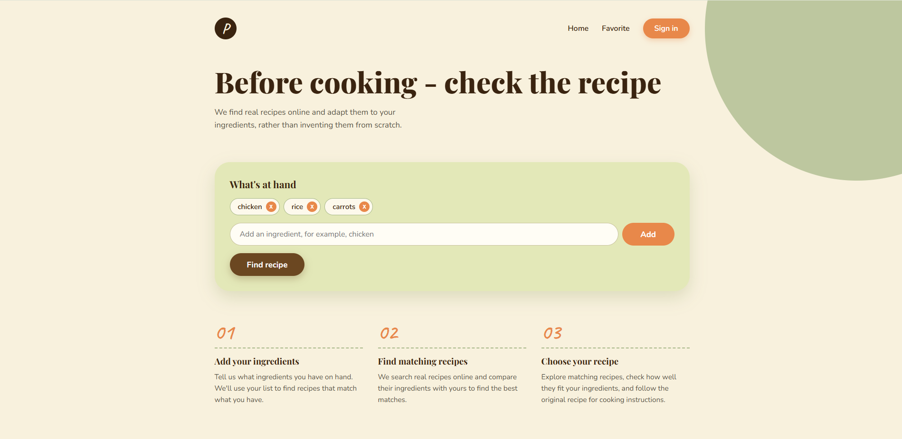
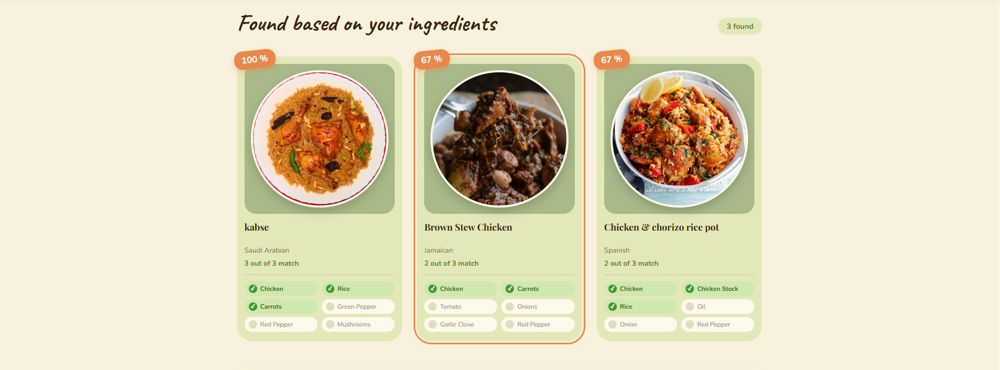
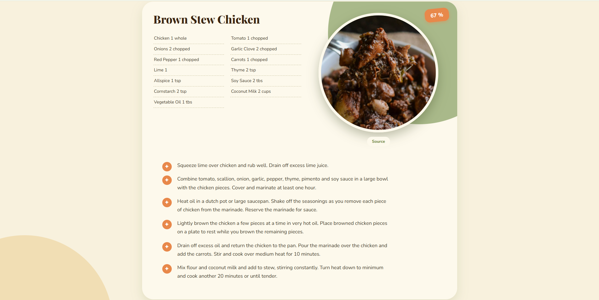

# Recipe Finder 

A web application that helps you discover recipes based on the ingredients you have available.

Select ingredients, find matching recipes, compare ingredient matches, and explore recipe details — all in one place.

## Screenshots

### Main Page


### Recipe Search Results


### Recipe Details


## Features

- **Ingredient Search** - Find ingredients using autocomplete suggestions.
- **Ingredient Validation** - Select ingredients from the available list.
- **Ingredient Management** - Add and remove ingredients, with a maximum of 6 ingredients per search.
- **Recipe Matching** - Discover recipes based on the ingredients you select.
- **Match Percentage** - See how many of your selected ingredients match each recipe.
- **Recipe Cards** - Browse recipe images and matching results.
- **Recipe Details** - View recipe ingredients, measurements, and cooking instructions.
- **Recipe Sources** - Access the original recipe source when available.
- **Responsive Interface** - A clean interface designed for convenient use.

## Tech Stack

**Frontend**
- HTML5
- CSS3
- JavaScript (ES Modules)
- Vite
- Fuse.js

**Backend**
- Node.js
- Express.js
- TheMealDB API
- In-memory caching

## Project Structure

```text
recipe-finder/
├── back/
│   ├── data/
│   │   └── ingredients.js
│   ├── middleware/
│   │   ├── errorHandler.js
│   │   └── rateLimit.js
│   ├── routes/
│   │   └── recipes.js
│   ├── services/
│   │   ├── mealDb.js
│   │   └── recipeService.js
│   ├── utils/
│   │   └── validation.js
│   ├── server.js
│   ├── package.json
│   └── package-lock.json
├── front/
│   ├── css/
│   │   └── style.css
│   ├── js/
│   │   ├── ingredients.js
│   │   ├── notifications.js
│   │   ├── recipes.js
│   │   ├── script.js
│   │   └── suggestions.js
│   └── index.html
├── screenshots/
│   ├── main.png
│   ├── found.png
│   └── selected.png
├── .gitignore
├── LICENSE
├── package.json
├── package-lock.json
├── vite.config.js
└── README.md
```

## Getting Started

### Prerequisites

- [Node.js](https://nodejs.org/) and npm
- [Git](https://git-scm.com/) (optional, for cloning the repository)

### Installation

Clone the repository:

```bash
git clone https://github.com/git-Alex-git/recipe-finder.git
cd recipe-finder
```

Install the root dependencies:

```bash
npm install
```

Install the backend dependencies:

```bash
cd back
npm install
cd ..
```

### Development

Start the backend in one terminal:

```bash
cd back
npm start
```

Start the frontend development server in a second terminal, from the project root:

```bash
npm run dev
```

Open the local URL displayed by Vite in your terminal, usually:

```text
http://localhost:5173
```

The Vite development server proxies API requests to the Express backend.

### Production

Build the frontend from the project root:

```bash
npm run build
```

Then start the backend:

```bash
cd back
npm start
```

Open:

```text
http://localhost:3000
```

In production, Express serves the built frontend from `front/dist`.

## How It Works

1. The user selects ingredients from the available ingredient list.
2. The frontend sends the selected ingredients to the Express backend.
3. The backend retrieves recipes from TheMealDB API.
4. Recipe results are compared against the selected ingredients.
5. Matching recipes are returned with their match counts and percentages.
6. The user can browse recipe cards and open individual recipe details.

The backend also uses in-memory caching to reduce repeated external API requests.

## API

The backend exposes the following endpoints:

| Method | Endpoint | Description |
|---|---|---|
| `GET` | `/ingredients` | Retrieves the available ingredients |
| `POST` | `/recipes` | Searches for recipes matching the selected ingredients |

The recipe search endpoint accepts an array of ingredient names in the request body.

Example:

```json
[
  "chicken",
  "rice",
  "garlic"
]
```

## Future Improvements

- User authentication and personal accounts
- Saving favorite recipes
- Persistent user preferences
- Additional recipe filters
- Improved recipe search and ranking

## Acknowledgements

- [TheMealDB](https://www.themealdb.com/) — Recipe data and images.
- [Fuse.js](https://www.fusejs.io/) — Fuzzy search for ingredient suggestions.
- [Vite](https://vite.dev/) — Frontend development and build tooling.
- [Express](https://expressjs.com/) — Backend framework.

## License

This project is licensed under the terms described in the [LICENSE](LICENSE) file.
